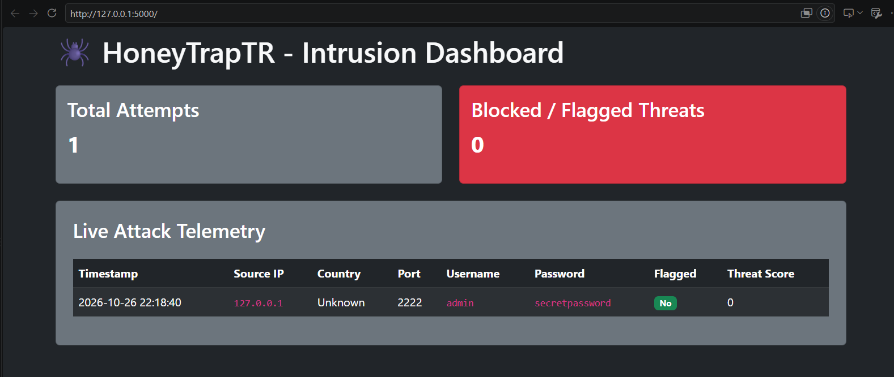

# 🕷️ HoneyTrapTR - Intrusion Dashboard

A lightweight, real-time security intrusion monitoring and telemetry dashboard designed to capture and display unauthorized access attempts and security events.

---

## 📊 Dashboard Preview



---

## ✨ Features

* **Real-Time Telemetry:** Tracks incoming connection attempts, capturing timestamps, source IPs, targeted ports, and authentication payloads.
* **Threat Analytics:** Monitors total connection attempts against flagged/blocked threats.
* **Interactive UI:** Clean, dark-mode administrative dashboard designed for rapid incident review.

---

## 🚀 Getting Started

1. **Clone the repository:**
   ```bash
   git clone (https://github.com/Isra-didagur/honeytrap.git)
   cd honeytrap
